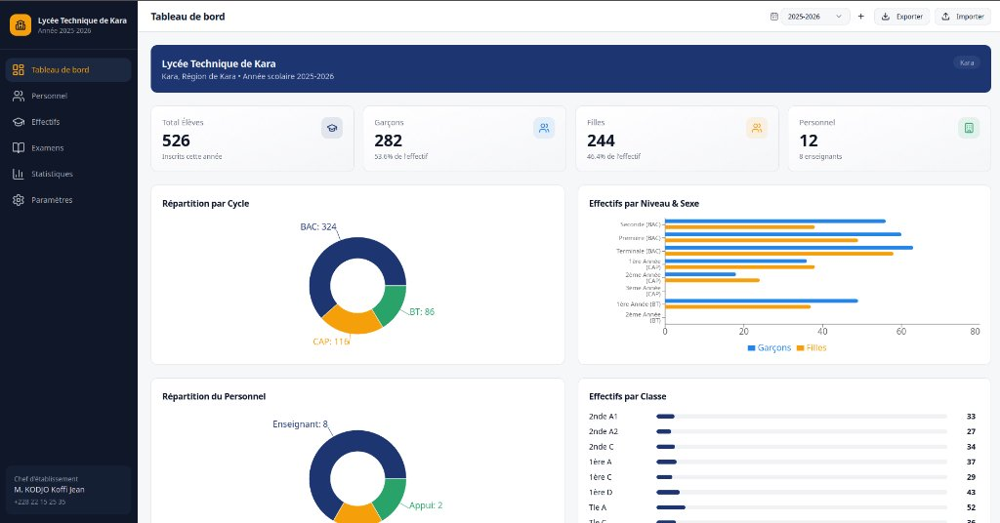
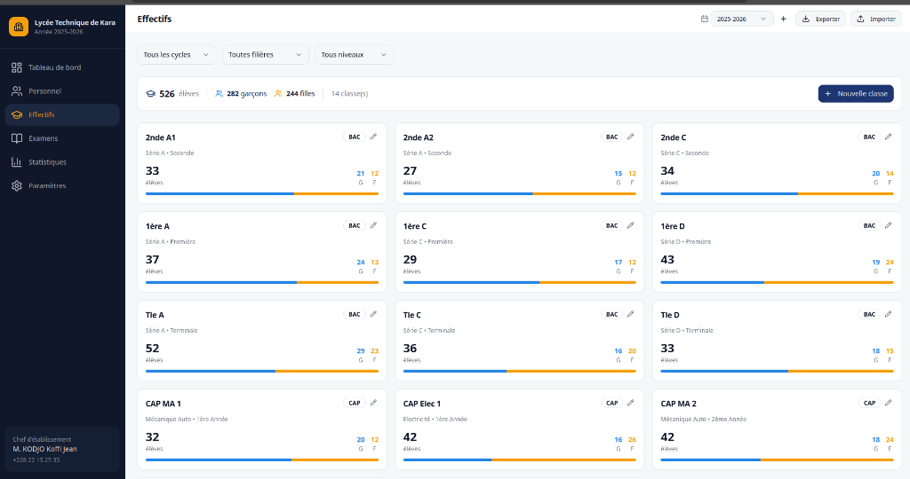
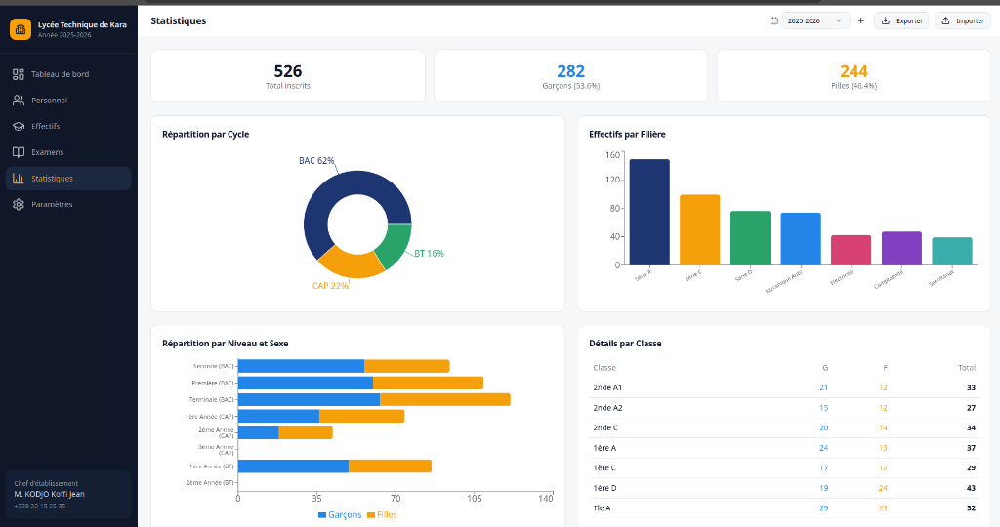

# School Statistics - Plateforme de Pilotage et Statistiques Scolaires

Systeme d'information et tableau de bord decisionnel concu pour la gestion administrative, le suivi pedagogique et l'analyse statistique des etablissements d'enseignement secondaire et technique (developpe et eprouve pour le Lycee Technique de Kara, Region de Kara, Togo).

L'application permet aux chefs d'etablissement, directeurs des etudes et inspections academiques de centraliser les effectifs scolaires, de suivre les ratios de parite filles-garcons, de piloter les corps enseignants et de generer des indicateurs fiables pour les rapports officiels.

---

## Contexte et Enjeux Educatifs

La gestion des donnees scolaires dans les lycees techniques et d'enseignement general presente des defis operationnels majeurs :
- Disparite des effectifs entre les cycles generaux (BAC), techniques (BT) et professionnels (CAP).
- Suivi rigoureux de la scolarisation feminine et de la parite de genre par filiere et par niveau.
- Agregation manuelle des statistiques pour les inspections ministerielles, source d'erreurs et de retards.
- Manque d'indicateurs visuels instantanes pour equilibrer les charges horaires et les affectations pedagogiques.

School Statistics repond a ces defis en automatisant la collecte, le calcul des indicateurs et l'exportation des donnees au format standardise de l'inspection.

---

## Apercu Visuel de la Solution

### 1. Tableau de Bord de Direction
Vue globale sur l'annee scolaire en cours : effectif total d'eleves, repartition garcons/filles, effectif du personnel enseignant et d'appui, ventilation par cycle (BAC, CAP, BT) et histogramme par niveau.



### 2. Gestion des Effectifs par Classe et Filiere
Cartes interactives par classe permettant de visualiser instantanement les effectifs, les ratios garcons/filles et le cycle associe pour l'ensemble des filieres generales et professionnelles (Mecanique Auto, Electricite, Series A, C, D).



### 3. Module d'Analyses Statistiques Avancees
Graphiques analytiques detailles : repartition par cycle d'etude, effectifs par filiere de formation, ventilation par niveau et sexe, et tableau recapitulatif classe par classe.



---

## Fonctionnalites Principales

### Pilotage des Effectifs et Classes
- **Suivi des effectifs en temps reel** : Comptabilisation automatique des eleves inscrits, repartis par sexe et par pourcentage d'effectif.
- **Organisation multi-cycles et multi-filieres** : Prise en charge des cursus de l'enseignement technique et secondaire :
  - Cycle BAC (Series Litteraires et Scientifiques : 2nde, 1ere, Terminale A, C, D).
  - Cycle BT (Brevet de Technicien : 1ere Annee, 2eme Annee).
  - Cycle CAP (Certificat d'Aptitude Professionnelle : Mecanique Automobile, Electricite, etc.).
- **Creation et configuration de classes** : Ajout dynamique de nouvelles classes avec association automatique de filiere et de niveau.

### Ressources Humaines et Personnel
- **Repertoire du personnel** : Suivi des effectifs d'enseignants et du personnel administratif et d'appui.
- **Indicateurs d'encadrement** : Ratios eleves/enseignant et repartition par specialite.

### Suivi des Examens et Statistiques Decisionnelles
- **Suivi des sessions d'examens** : Preparation des listes de candidats officiels par serie et filiere.
- **Visualisations graphiques** : Diagrammes en beignets, graphiques en barres horizontales et jauges de progression adaptatives.
- **Filtres multicriteres** : Segmentation rapide par annee academique, cycle d'etude, niveau ou filiere.

### Interoperabilite et Exports
- **Passerelle d'import/export inspection** : Formats d'echange de donnees conformes aux exigences des inspections regionales et nationales.
- **Exportation rapide** : Generation de bilans et de rapports statistiques imprimables et archivables.
- **Double deploiement Web et Bureau** : Utilisation possible en application web classique ou en logiciel de bureau autonome grace a Electron.

---

## Stack Technique

| Categorie | Technologies |
| :--- | :--- |
| **Framework Frontend** | React 18, TypeScript, Vite |
| **Design System & Styles** | Tailwind CSS, Shadcn UI, Radix UI Primitives, Lucide Icons |
| **Visualisation de Donnees** | Recharts (Graphiques de repartition, barres de parite) |
| **Formulaires & Validation** | React Hook Form, Zod |
| **Gestion du Cache & Requetes** | TanStack React Query |
| **Persistance & ORM** | Prisma ORM, PostgreSQL / SQLite |
| **Support Application Bureau** | Electron (Option Desktop multiplateforme) |

---

## Installation et Lancement Local

### 1. Prerequis
- Node.js (version 18 ou superieure)
- npm, yarn ou bun

### 2. Cloner le depot
```bash
git clone https://github.com/maximedefaleouna/school-stats.git
cd school-stats
```

### 3. Installer les dependances
```bash
npm install
```

### 4. Configuration de l'environnement
Creez un fichier `.env` a partir de `.env.example` si necessaire pour configurer les variables d'environnement.

### 5. Demarrer le serveur de developpement
```bash
npm run dev
```
L'application demarrera a l'adresse locale indiquee par Vite (generalement `http://localhost:5000` ou `http://localhost:5173`).

### 6. Executer en mode Application Bureau (Electron)
```bash
npm run electron:dev
```

### 7. Compiler pour la production
```bash
npm run build
```

---

## Auteur

**Maxime DEFALEOUNA**
- Profil GitHub : [@maximedefaleouna](https://github.com/maximedefaleouna)
